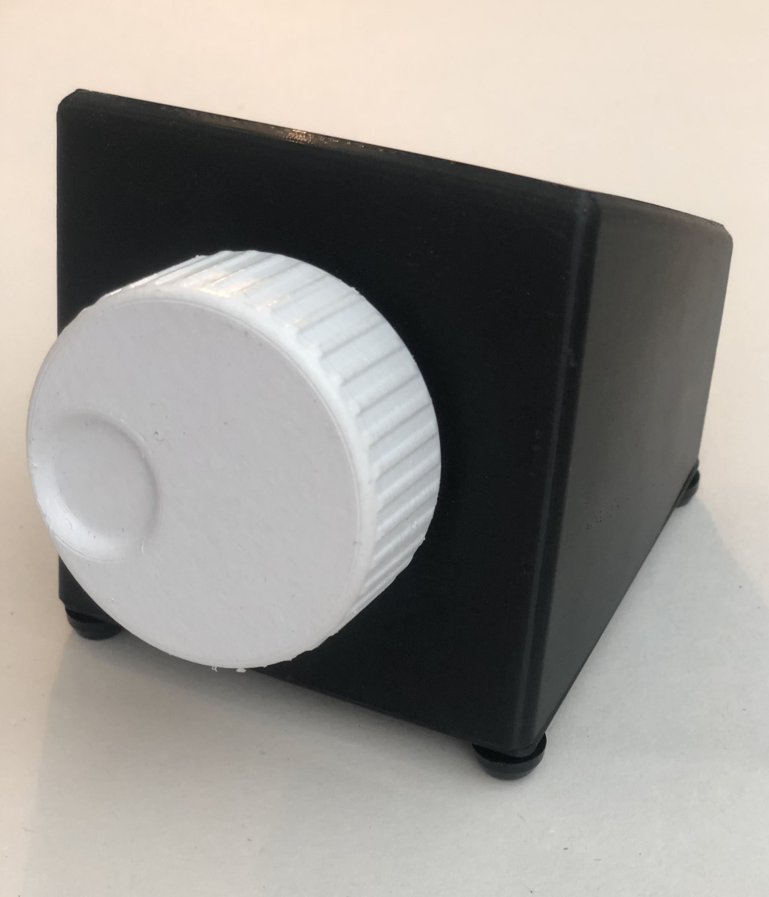
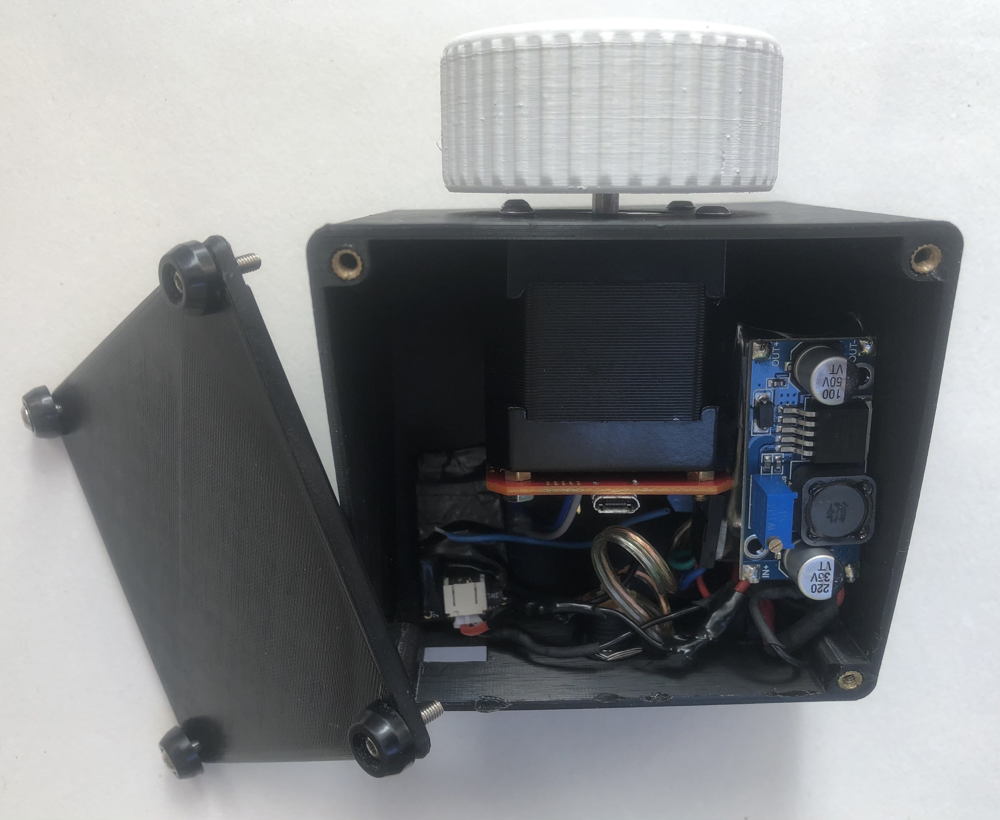
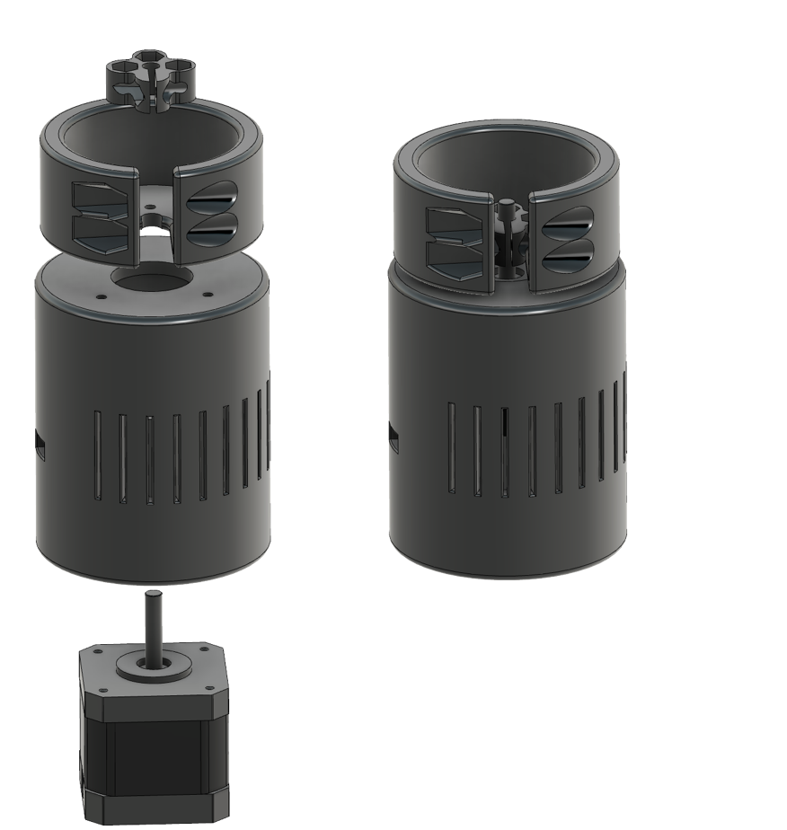
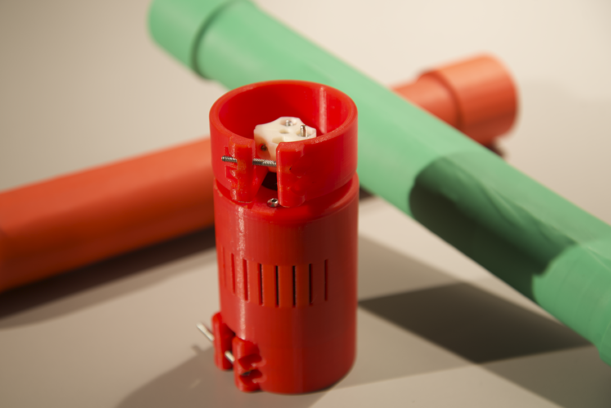

# TorqueTuner: A self contained module for designing rotary haptic force feedback for digital musical instruments.

TorqueTuner  is  an  embedded  module  that  allows  Digital Musical Instrument (DMI) designers to map sensors to parameters  of  haptic  effects  and  dynamically  modify  rotary force  feedback  in  real-time. It comes with an embedded collection of haptic effects, and a is wireless bi-directional interface through [libmapper](https://github.com/libmapper/libmapper).

[Demonstration video](https://vimeo.com/404592134)  

The hardware is based on the ESP32 microcontroller and the [mechaduino](https://github.com/jcchurch13/Mechaduino-Hardware) platform, to implement a force feedback rotary encoder with 3600 PPR ~= 0.1 degree resolution that can display forces up to 45 Ncm (63.7oz.in).

## Installation

Clone this repository and all of its submodules:
	
    git clone --recursive https://gitlab.com/idmil/haptics/torquetuner

### Program mappings on you computer

### Install Python3 and Pyserial
on Linux:

    sudo apt install python3 python-is-python3
    sudo apt-get install python3-serial
#### Install libmapper

on MacOs:

    git clone https://github.com/libmapper/libmapper.git
    cd libmapper
    ./autogen.sh
    make
    make install

#### Install webmapper

TODO

### Program embedded devices
#### Install libmapper arduino library for ESP32
<update to include a release.zip as submodule>
The libmapper arduino library needs to be compiled and moved to the Arduino libraries folder. See [instructions](https://gitlab.com/idmil/haptics/libmapper-arduino/-/tree/rotarep)

#### Upload firmware

Upload mechaduino firmware
1. Open software/Mechaduino-firmware/Mechaduino/Mechaduino.ino in arduino  
2. Choose board -> arduino zero  
3. Upload  

Upload ESP32 firmware

1. Install [arduino-ESP32](https://github.com/espressif/arduino-esp32/blob/master/docs/arduino-ide/boards_manager.md) using boards manager
2. In Arduino IDE, go to preferences, click under "More preferences cab be edited directlyh in the file".   packages>esp32>hardware>esp32>1.0.6>tools>sdk>include>lwip>arpa and access the inet.h file. Apply the following modifications:
change `#include "../../../lwip/src/include/lwip/inet.h"` to `#include "lwip/inet.h"` . 
3. Open software/TorqueTuner-ESP32/firmware/ESP32/ESP32.ino in arduino
4. Change part of the code as displayed [here](https://gitlab.com/idmil/haptics/TorqueTuner-ESP32/-/commit/84bfbb211ef643d7faa20d303f8e1e38cba5f807) 
5. Choose board -> TinyPico 
6. Download TinyPico Arduino Helper (https://github.com/tinypico/tinypico-arduino/tree/master/TinyPICO-Helper) to the Arduino libraries folder, or directly through the Arduino IDE Library Manager.
7. Run `update-library.sh`  in the libmapper directory. (torquetuner>software>libmapper_arduino)
8. Modify WIFI credentials correspondingly (see around line 15-20)
9. Upload. *(in case of error: _selected serial port could not open port /dev/ttyUSB0_, make sure that access to USB is not restricted. To solve this, run `sudo usermod -a -G dialout $USER` and restart).

#### Calibrate
Follow [instructions](https://github.com/jcchurch13/Mechaduino-Firmware#calibration-routine) on calibrating the magnetic encoder with the known step angle given. 

## Usage
TODO Write about how to use libmapper, supported audio environments and examples

## Building the hardware

## T-stick integration

